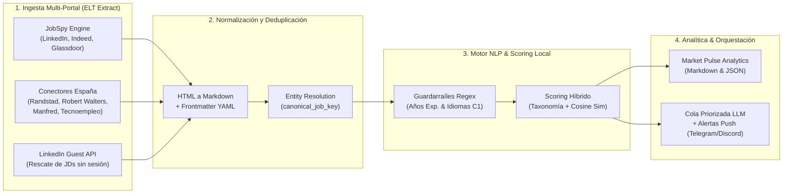

# 📊 Job Market Intelligence & NLP Engine — Architecture & Technical Showcase

[-brightgreen.svg)](.github/workflows/ci.yml)
[](https://www.python.org/downloads/)
[-informational.svg)](#1-ingesta-multi-portal-resiliente-samplesspanish_portalspy)
[-brightgreen.svg)](tests/test_showcase.py)
[](LICENSE)
[](#)

> [!IMPORTANT]
> **📌 Nota sobre Arquitectura y Muestras de Código (*Code Samples*)**
>
> **Job Market Intelligence** es un **pipeline ELT de ingeniería de datos, extracción web multi-portal y análisis NLP del mercado laboral tecnológico**. El repositorio completo de orquestación (`Nachovelher/Job-Market-Intelligence`) se mantiene en privado al contener configuraciones de entorno, reglas de notificación personalizadas y cachés locales de ejecución.
>
> Este repositorio público actúa como **escaparate técnico y de arquitectura** e incluye:
> - El estudio empírico generado por el pipeline sobre el ecosistema de datos en Barcelona ([`docs/MARKET_PULSE_BARCELONA.md`](docs/MARKET_PULSE_BARCELONA.md)).
> - **Módulos reales de extracción, deduplicación, clasificación NLP y analítica en [`samples/`](samples/):**
>   - [`samples/spanish_portals.py`](samples/spanish_portals.py) — Conectores especializados con impersonación TLS (`curl_cffi`), extracción de grafos `Schema.org/JobPosting` en JSON-LD, hidratación SSR Next.js (`__NEXT_DATA__`) y normalización HTML $\rightarrow$ Markdown.
>   - [`samples/jd_matcher.py`](samples/jd_matcher.py) — Motor determinista de reglas NLP multilingüe (detección de umbrales de experiencia e idiomas obligatorios en ES/EN) y puntuación híbrida mediante taxonomías ponderadas + similitud coseno TF-IDF.
>   - [`samples/market_pulse.py`](samples/market_pulse.py) — Resolución de entidades inter-portal (`canonical_job_key`, `dedupe_across_sites`) y agregación estadística de demanda tecnológica.
>   - [`tests/test_showcase.py`](tests/test_showcase.py) — Suite de tests unitarios ejecutada automáticamente en GitHub Actions (Python 3.11 y 3.12).

---

## 🎯 Propósito e Ingeniería del Sistema

Los portales de empleo modernos publican la misma vacante replicada en múltiples agregadores (LinkedIn, Indeed, Glassdoor, Randstad, Robert Walters, Manfred, Tecnoempleo) con formatos heterogéneos (SPAs en Next.js, bloques JSON-LD con caracteres de control sin escapar, páginas protegidas por *fingerprinting* TLS o enlaces que caducan tras pocos días).

Este proyecto resuelve el problema mediante un **pipeline ELT modular en Python** que:
1. **Extrae y normaliza** descripciones completas de puesto (*Job Descriptions*) desde **7 portales internacionales y españoles** convirtiendo el HTML crudo en documentos Markdown estructurados con metadatos YAML (*frontmatter*).
2. **Resuelve duplicados entre portales (*Cross-Portal Entity Resolution*)** generando claves canónicas inmunes a tildes, signos de puntuación y sufijos societarios (`S.L.`, `S.A.`, `Spain`), conservando automáticamente la versión con mayor riqueza descriptiva.
3. **Filtra y puntúa semánticamente en local (0–100%)** cada vacante antes de invocar modelos de lenguaje (LLMs), descartando en milisegundos ofertas que incumplen restricciones duras (exigencia de $>N$ años de experiencia o terceros idiomas obligatorios a nivel C1/nativo) y ordenando la cola por afinidad técnica.
4. **Genera inteligencia de mercado (*Market Pulse*)** cuantificando la cuota real de mercado de cada tecnología (SQL, Python, Power BI, Qlik, sistemas ERP, Cloud, dbt, LLMs) en el área metropolitana de Barcelona.

---

## 🏗️ Arquitectura del Pipeline



---

## 🔧 Pilares Técnicos

### 1. Ingesta Multi-Portal Resiliente ([`samples/spanish_portals.py`](samples/spanish_portals.py))
* **Extracción `Schema.org/JobPosting` tolerante a fallos (Randstad y Tecnoempleo):** En lugar de depender de selectores CSS frágiles que se rompen con cada rediseño visual, el scraper localiza los bloques `<script type="application/ld+json">`, sanea caracteres de control no escapados (`json.loads(..., strict=False)`) y reconstruye la descripción completa junto con `responsibilities`, `experienceRequirements` y ubicación.
* **Hidratación SSR Next.js y filtrado por Sitemap (Manfred):** Descarga el índice `sitemap-offers.xml`, filtra por expresión regular los *slugs* técnicos más recientes y extrae el árbol de estado de servidor (`__NEXT_DATA__` $\rightarrow$ `props.pageProps.offer`), obteniendo la banda salarial exacta (`salaryMin`–`salaryMax`), modalidad remota y estado de activación.
* **Rescate asíncrono sin navegador (`fetch_linkedin_guest_jd`):** Cuando un agregador devuelve una URL de LinkedIn truncada o sin cuerpo por *rate-limiting*, el conector consulta el endpoint ligero `/jobs-guest/jobs/api/jobPosting/{id}` con impersonación TLS de Chrome (`curl_cffi`), logrando recuperar el 100% del texto sin levantar instancias pesadas de Playwright/Selenium.

### 2. Resolución de Entidades Inter-Portal ([`samples/market_pulse.py`](samples/market_pulse.py))
Una misma vacante suele publicarse simultáneamente en el portal corporativo, en LinkedIn, en Indeed y en una consultora de selección. La función `dedupe_across_sites()` normaliza mediante descomposición Unicode `NFKD` el título del puesto y la raíz de la empresa (`canonical_job_key`), agrupa las colisiones entre portales y selecciona determinísticamente el registro con mayor longitud de descripción (`_jd_len`).

### 3. Clasificación NLP y Similitud Léxica ([`samples/jd_matcher.py`](samples/jd_matcher.py))
* **Extractor multilingüe de seniority (`extract_min_experience_years`):** Evalúa expresiones regulares en español e inglés (*"mínimo de 5 años"*, *"at least 6+ years of experience"*, *"experiencia mínima: 4 a 6 años"*) para detectar barreras duras de experiencia antes de consumir tokens de inferencia.
* **Scoring híbrido (Taxonomía de Dominio + Similitud Coseno):** Combina pesos explícitos por familias tecnológicas (`SQL`, `ERP`, `Supply Chain`, `Qlik`, `Master Data`, `BI / Dashboards`, `Python`, `Data / ETL`, `IA / Automatización`) con la similitud del coseno entre los vectores de frecuencia léxica del documento y el perfil de referencia.

---

## 📈 Caso de Estudio Real: *Barcelona Tech & Data Market Pulse*

El informe completo generado sobre una muestra deduplicada de **71 ofertas técnicas en Barcelona** está disponible en [`docs/MARKET_PULSE_BARCELONA.md`](docs/MARKET_PULSE_BARCELONA.md):

| Top 8 Tecnologías Demandadas en Barcelona | Categoría | Frecuencia | Cuota de Mercado |
| :--- | :--- | :---: | :---: |
| **1. Python (`pandas`, `numpy`, `scikit-learn`)** | Programación & Data Science | 43 / 71 | **60.6%** |
| **2. SQL (`T-SQL`, `PL/SQL`, `PostgreSQL`, `SQL Server`)** | Datos & Bases de Datos | 41 / 71 | **57.7%** |
| **3. LLMs / GenAI / Agentes** | IA & Automatización | 29 / 71 | **40.8%** |
| **4. Power BI (`DAX`, `Power Query`)** | Business Intelligence | 24 / 71 | **33.8%** |
| **5. AWS (`S3`, `Redshift`, `Athena`, `Glue`)** | Cloud & Big Data | 19 / 71 | **26.8%** |
| **6. Automatización (`Power Automate`, `n8n`, `RPA`)** | IA & Automatización | 19 / 71 | **26.8%** |
| **7. ETL / Data Warehousing / Modelado Dimensional** | Data Engineering | 17 / 71 | **23.9%** |
| **8. Supply Chain / Logística / Compras / ERP** | Dominio & Operaciones | 16 / 71 | **22.5%** |

---

## 🧪 Ejecución de la Suite de Tests

```bash
pip install -r requirements.txt
python -m unittest discover -s tests -v
```

## 📄 Licencia

Distribuido bajo la licencia **MIT**. Consulta el archivo [`LICENSE`](LICENSE) para más detalles.
